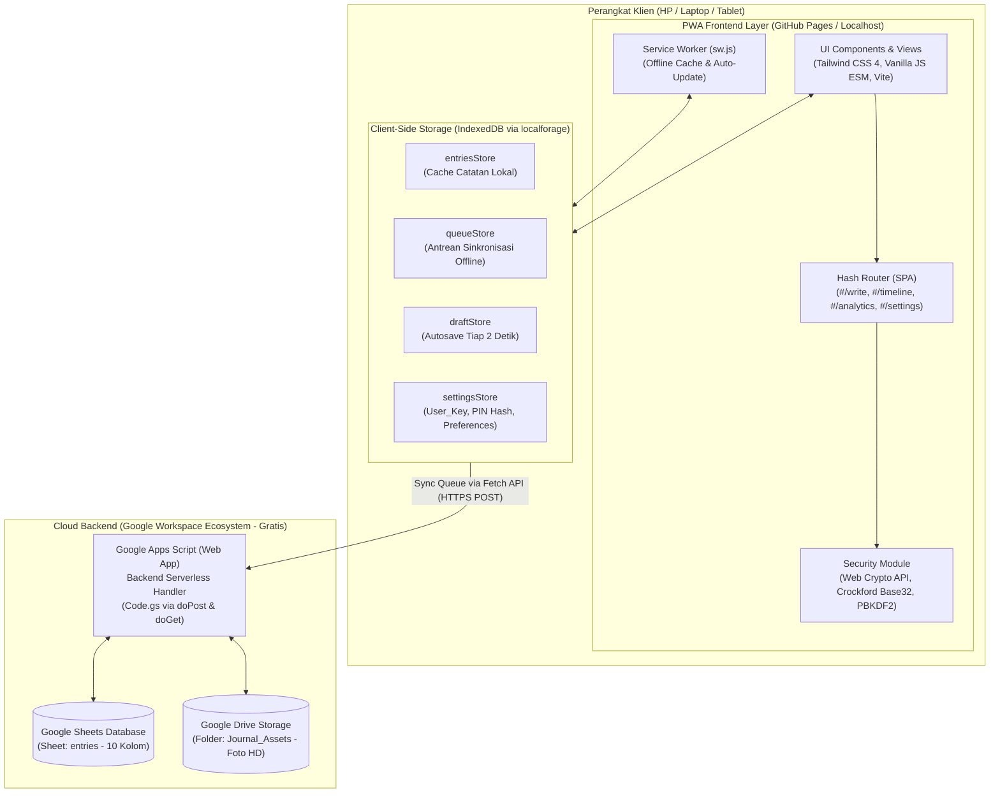
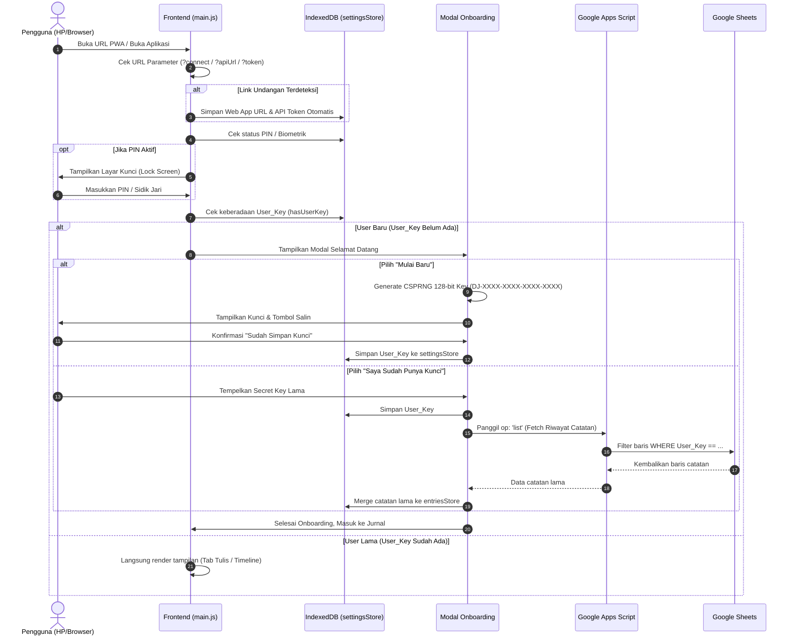
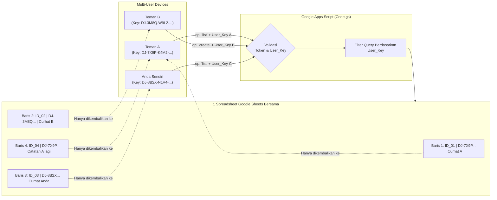
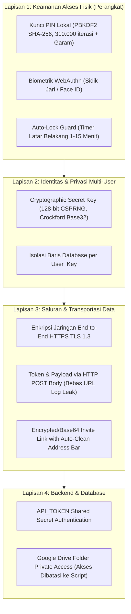

# Arsitektur & Alur Sistem (Flow) — Daily Journal PWA

Dokumen ini mendokumentasikan spesifikasi arsitektur, tumpukan teknologi (*tech stack*), alur kerja (*system workflow*), penanganan masalah (*error handling*), dan protokol keamanan proyek **Daily Journal PWA**. Dokumen ini dirancang khusus sebagai panduan visualisasi diagram arsitektur.

---

## 1. Ringkasan Tech Stack & Penempatan Komponen



### Rincian Tumpukan Teknologi:
| Komponen | Teknologi / Library | Lokasi / Hosting | Peran Utama |
| :--- | :--- | :--- | :--- |
| **Frontend Shell** | HTML5, Modern Vanilla JS (ES Modules) | GitHub Pages (Statis) | Tampilan antarmuka responsif tanpa runtime framework berat. |
| **Styling** | Tailwind CSS v4 (`@tailwindcss/vite`) | Bundled via Vite | Desain *light cream*, responsif, dukungan Dark Mode & Safe Area HP. |
| **Bundler & Build Tool**| Vite 6 | GitHub Actions (CI/CD) | Kompilasi cepat, hash cache buster, pemrosesan aset. |
| **PWA & Cache** | Service Worker, Web App Manifest | Browser Perangkat | Instalasi *standalone* di Android/iOS, *offline-first*, dan *auto-update*. |
| **Client Storage** | IndexedDB via `localforage` | Browser / Storage HP | Database lokal instan: catatan, antrean offline, draf, dan setting. |
| **Grafik & Data** | Chart.js | Bundled via npm | Visualisasi tren mood dan heatmap aktivitas 53 minggu. |
| **Backend Engine** | Google Apps Script (V8 Runtime) | Serverless Google Cloud | Endpoint API Web App (`doPost`/`doGet`), LockService, otentikasi token. |
| **Database Utama** | Google Sheets | Google Cloud Personal | Penyimpanan data terstruktur (10 kolom) dengan isolasi `User_Key`. |
| **Penyimpanan Media** | Google Drive API | Google Cloud Personal | Folder privat `Journal_Assets` untuk menampung gambar resolusi tinggi (HD). |

---

## 2. Alur Sistem dari Awal sampai Akhir (End-to-End Workflow)

### A. Alur Inisialisasi & Onboarding Pertama Kali (Boot Sequence)



---

### B. Alur Penulisan & Penyimpanan Catatan (Dual-Storage & Offline-First)

```mermaid
sequenceDiagram
    autonumber
    actor User as Pengguna
    participant UI as Write View (write.js)
    participant Media as Image Processor (image.js)
    participant IDB as IndexedDB (localforage)
    participant Sync as Sync Engine (sync.js)
    participant GAS as Google Apps Script
    participant Sheet as Google Sheets
    participant Drive as Google Drive

    User->>UI: Ketik catatan, pilih mood, lampirkan foto
    UI->>UI: Auto-detect tag (#topik, @orang) & autosave draft (tiap 2 detik)
    User->>UI: Klik tombol "Simpan Catatan"
    UI->>Media: Proses foto yang diunggah
    Media->>Media: EXIF Auto-Orient & Resize 1080px (HD JPEG, Q=0.8)
    Media->>Media: Generate Thumbnail Mikro (150px Base64, ~8-10 KB)
    UI->>IDB: Simpan catatan instan ke 'entriesStore' (ID, Timestamp, Mood, Tags, Teks, Thumb)
    UI->>IDB: Tambahkan operasi ke 'queueStore' (op: 'create', status: 'pending')
    UI-->>User: Tampilkan toast "Disimpan di perangkat (offline-ready)"
    
    UI->>Sync: Trigger flushQueue()
    alt Perangkat Online & API Config Ada
        Sync->>IDB: Ambil antrean pending
        Sync->>GAS: Kirim POST JSON (Token, User_Key, op: 'create', entry, ImageHD)
        GAS->>GAS: Validasi API_TOKEN & User_Key
        opt Jika ada Foto HD
            GAS->>Drive: Buat file gambar di folder Journal_Assets
            Drive-->>GAS: Return Drive_File_ID
        end
        GAS->>Sheet: Tambah baris baru (10 Kolom lengkap)
        Sheet-->>GAS: Sukses
        GAS-->>Sync: Return { ok: true, fileId: ... }
        Sync->>IDB: Hapus item dari queueStore
        Sync-->>User: Update Sync Pill -> "Tersinkron"
    else Perangkat Offline / Gagal Jaringan
        Sync-->>User: Update Sync Pill -> "Disimpan di perangkat (N)"
        Note over Sync: Disimpan di queueStore; sinkronisasi otomatis<br/>begitu koneksi internet pulih.
    end
```

---

### C. Alur Multi-User Data Isolation (Isolasi Antar Pengguna)



---

## 3. Strategi Penanganan Masalah (Error Handling)

| Skenario Kendala | Titik Masalah | Solusi & Mekanisme Penanganan (*Handling*) |
| :--- | :--- | :--- |
| **Koneksi Internet Putus (Offline)** | Jaringan Klien | Operasi tulis tetap 100% berjalan. Data disimpan ke `entriesStore` dan antrean `queueStore`. Event listener `window.ononline` dan `visibilitychange` otomatis memicu `flushQueue()` saat internet aktif kembali. |
| **Ganti Perangkat / Install Ulang** | Kehilangan Data Lokal | Modul [`restoreUserEntries()`](file:///d:/Coding/PWA-4/frontend/src/data/restore.js) otomatis menarik hingga 500 catatan dari Google Sheets berdasarkan `User_Key` yang dimasukkan pada wizard pemulihan. |
| **Pembaruan Aplikasi (*Update Release*)** | Browser Cache Lama | Service Worker menggunakan strategi **Network-First** untuk navigasi (HTML) dan **Stale-While-Revalidate/Cache-First** untuk bundel aset. Begitu ada rilis baru, SW memicu `skipWaiting()` dan `controllerchange` mereload halaman secara mulus. |
| **Konflik Edit Data (*Race Condition*)** | Sinkronisasi Paralel | Menggunakan strategi **Last-Write-Wins (LWW)** berdasarkan perbandingan kolom `Updated_At`. Pada sisi backend GAS, digunakan `LockService.getScriptLock()` dengan timeout 20 detik untuk mencegah tumpang tindih penulisan baris. |
| **Struktur Database Sheets Berubah** | Versi Kolom Lama | Fungsi `sheet_()` memiliki logika **Auto-Migration & Self-Healing**: mendeteksi apakah kolom `User_Key` sudah ada. Jika belum, kolom B otomatis disisipkan dan data lama dipertahankan dengan label default. |
| **Kegagalan API GAS / Limit Kuota** | Backend Google | Antrean menerapkan *exponential backoff* dan penandaan status `failed` pada antrean bermasalah tanpa menghapus catatan lokal. Pengguna dapat mengulang manual di tab Pengaturan. |

---

## 4. Arsitektur Keamanan (Security Matrix)



### Rincian Fitur Keamanan:
1. **Zero Exposure of Personal Diary to Strangers**:
   Meskipun repositori frontend bersifat publik, database Google Sheets terlindungi oleh `API_TOKEN`. Selain itu, data antar sesama teman yang menggunakan server bersama diisolasi secara mutlak oleh `User_Key`.
2. **Kunci Kriptografi Entropi Tinggi**:
   Format `DJ-XXXX-XXXX-XXXX-XXXX` dihasilkan menggunakan modul `crypto.getRandomValues(new Uint8Array(16))` sehingga memiliki entropi $2^{128}$ kemungkinan, mustahil untuk ditebak (*brute-force proof*).
3. **Kunci PIN Kebal Analisis Waktu (Constant-Time Comparison)**:
   Verifikasi hash PIN dienkripsi menggunakan PBKDF2 SHA-256 dengan perhitungan waktu perbandingan yang konstan untuk mencegah serangan *timing attack*.
4. **Pembersihan Otomatis URL (*History Cleaning*)**:
   Ketika teman membuka aplikasi melalui tautan undangan (*Invite Link*), skrip [`invite.js`](file:///d:/Coding/PWA-4/frontend/src/components/invite.js) segera menyerap kredensial ke IndexedDB dan membersihkan parameter token dari address bar peramban menggunakan `history.replaceState()`.

---

## 5. Panduan Pembuatan Diagram Visual

Saat Anda memindahkan dokumen ini ke alat desain diagram (seperti Figma, Draw.io, Whimsical, atau Eraser.io), gunakan pembagian 4 zona visual berikut:

1. **Zona Biru / Kiri (Klien Frontend)**:
   - Komponen UI & Navigasi (PWA).
   - Service Worker & Cache Storage.
   - IndexedDB (4 Store: `entries`, `queue`, `draft`, `settings`).
2. **Zona Kuning / Tengah (Protokol Sinkronisasi & Keamanan)**:
   - Filter `User_Key` kriptografis.
   - Auto-lock & Biometrik guard.
   - Antrean Offline (`queueStore` -> `flushQueue`).
3. **Zona Hijau / Kanan (Backend Serverless Google)**:
   - Web App Google Apps Script (`Code.gs`).
   - LockService & Router Operasi (`create`, `update`, `delete`, `list`, `setup`).
4. **Zona Abu-Abu / Bawah (Penyimpanan Cloud)**:
   - Google Spreadsheet (Tabel Data 10 Kolom).
   - Google Drive Folder (`Journal_Assets` untuk file gambar biner).

